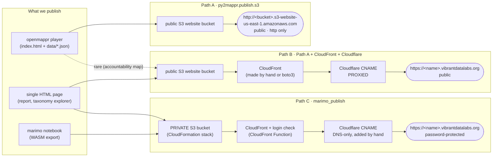
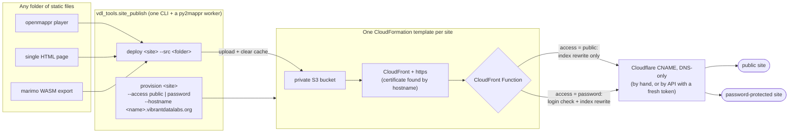

# Publishing static sites: where we are, and one way forward

*For review with Zein. Written 2026-11-18, after publishing
climate-finance-data-infrastructure.vibrantdatalabs.org hit several problems.*

**Short version.** vdl-tools has two separate publishing tools that do overlapping jobs in
different ways:

- **`py2mappr.publish`** (old) — used by almost every openmappr player. It is public only, and
  its CloudFront and Cloudflare steps are broken.
- **`marimo_publish`** (new, #181) — used by the 7 prospects sites. It is password-only, but its
  setup is much more solid.

We propose merging them into **one tool**: public *or* password-protected, for any folder of
static files (an openmappr player, a marimo export, or a single HTML page).

---

## 1. The three ways we publish today

| | **A. py2mappr `s3`** | **B. py2mappr `s3` + `cloudfront` + `cloudflare`** | **C. `marimo_publish`** |
|---|---|---|---|
| Used by | ~20 player build scripts across the VDL repos | accountability.vibrantdatalabs.org (GCA map), climate-health-taxonomy, climate-finance-data-infrastructure | 7 `*-prospects` sites (philanthropic-prospects), marimo apps |
| Who can see it | anyone | anyone | login required (HTTP basic auth) |
| Address | S3 website URL, **http only** | custom domain, https | custom domain, https |
| Bucket | **public** (public-read policy) | **public** | private; only CloudFront can read it |
| Setup | automatic on first upload | partly automatic; DNS by hand (see issues) | one CLI command per step; repeatable (CloudFormation) |
| Updates show up | immediately | after ~2–4 min (short CloudFront cache) | immediately (no-cache headers + cache clear on every deploy) |
| File types | only html, json, png, jpg, gif, svg, sh; anything else raises | same | anything (AWS CLI guesses the type) |
| Subfolders | one level only (deeper paths get flattened) | same | any depth |
| Teardown | delete the bucket by hand | delete bucket and distribution by hand | empty the bucket, then delete the stack (no teardown command yet) |

The dashboards (usclimate, drawdown, oe-nature-tagging, …) are on Vercel and outside the scope of
this doc.

## 2. Problems found on 2026-11-18

All but the last were found while publishing climate-finance-data-infrastructure with path B.

1. **`py2mappr/publish/cloudfront_worker.py` crashes** with `KeyError: 'Items'`. It reads
   `Aliases.Items[0]` on every distribution in the account, and some distributions have no custom
   domain. So path B fails in the current AWS account (corporate-account's build_gca_player_2024.py used it for the accountability map).
2. **The same worker sets `redirect-to-https`**, which causes a redirect loop when the Cloudflare
   record is *proxied*. Climate-health-taxonomy worked around this by switching to `allow-all` after
   the distribution was created. *Likely cause, not verified:* the zone's Cloudflare SSL mode is
   "Flexible", so Cloudflare talks to CloudFront over plain http. The prospects sites don't have
   this problem because their records are DNS-only.
3. **`config.ini [aws] acm_certificate` is the `*.openmappr.org` certificate.** CloudFront rejects
   it for a vibrantdatalabs.org address. `marimo_publish domain` avoids this by looking the
   certificate up in ACM by hostname. ACM holds three wildcard certificates: `*.openmappr.org`,
   `*.vibrantdatalabs.org` and `*.climatefinancetracker.com`.
4. **`config.ini [cloudflare] api_key` is invalid** (the API returns 401). No current site relies on
   it, because every CNAME has been added by hand in the Cloudflare dashboard. It is unknown how long
   it has been broken.
5. **Two DNS conventions.** Path B uses proxied records and path C uses DNS-only records. Each needs a
   different CloudFront setting, so mixing them up breaks the site.
6. **Path A serves players over http only, from public buckets.** This is a known limitation rather
   than a new bug: browsers mark these links "Not secure", and anything uploaded is world-readable.

## 3. Options for climate-finance-data-infrastructure

Live and public since 2026-11-18 on path B: https://climate-finance-data-infrastructure.vibrantdatalabs.org
(S3 bucket `vdl-climate-finance-data-infrastructure`, CloudFront `EDFQODYMER4BR`, proxied CNAME).
The remaining choice is whether to keep it that way.

| | **Keep it public (path B, as built)** | **Make it password-protected (path C)** |
|---|---|---|
| To do | nothing (optionally turn on Cloudflare "Always Use HTTPS"; plain http still serves the page) | rerun with `marimo_publish` (credentials → domain → provision → deploy); switch the CNAME to the new target, **DNS-only** |
| Readers | anyone with the link; search engines can index it | only people given the password |
| Fits the purpose? | yes, if it is meant to be shared freely | adds friction for an outreach page |
| Cleanup | none | delete the public bucket and CloudFront distribution from path B |
| Debt | one more site on the path we want to retire; its publish script is a one-off | none beyond today |

Either way, the build and publish scripts should move from a scratch folder into a repo.

## 4. Proposal: one publisher for every static site

**What it would be.** `marimo_publish` already does most of this well. The proposal is to generalize
it and retire `py2mappr.publish`'s S3, CloudFront and Cloudflare workers.

- **One switch for access.** `--access public|password` changes only the CloudFront Function: it
  either checks the login and rewrites folder URLs, or only rewrites folder URLs. The bucket is
  private in both cases, which means no more public-read buckets.
- **Any folder of static files.** It deploys a player's output folder, a marimo export or a one-page
  site the same way. `deploy` already uploads with `aws s3 cp`, which handles any file type and any
  folder depth.
- **The certificate is chosen by hostname** (`*.vibrantdatalabs.org`, `*.openmappr.org`,
  `*.climatefinancetracker.com`), so it is never read from `config.ini`.
- **One DNS convention: DNS-only.** CloudFront then serves https directly with our certificate, which
  removes the redirect-loop problem. The CNAME stays a by-hand step unless we issue a new Cloudflare
  token limited to editing DNS in the vibrantdatalabs.org zone.
- **Works from player build scripts.** Add a py2mappr worker, e.g. `publish.site("my-map",
  access="public")`, so a player script swaps `publish.s3(bucket)` for one line. The marimo-specific
  parts (`audit`, `export`) stay as they are and feed the same `deploy`.
- **Repeatable and removable.** Each site is one CloudFormation stack, so provisioning again is safe.
  Add a `teardown` command (empty the bucket, then delete the stack). Keep the `--apply` dry-run default.

**Migration.**

- Existing path-A players keep working; nothing breaks.
- A player moves to the new tool only when it is next rebuilt, or when it needs https or a custom
  domain.
- Climate-health-taxonomy and climate-finance-data-infrastructure can move over by provisioning a
  stack, deploying, switching the CNAME and then deleting the old bucket and distribution.

## 5. Questions for Zein

1. **Generalize `marimo_publish` in place, or add a new `site_publish` module** that marimo_publish
   calls into? (The CLI name and backward compatibility for `publish_search.py` depend on this.)
2. **Public mode with no Function at all, or a Function that only rewrites folder URLs?** Players
   probably need the rewrite only if they use folder URLs. Untested.
3. **Do players work behind the password?** Browsers normally resend basic-auth credentials for the
   player's `data/*.json` requests on the same site, but we haven't tested a player behind path C.
4. **Cloudflare:** issue a token limited to DNS edits and automate the CNAME, or keep it by hand?
   Also confirm the zone's SSL mode, which bears on problem 2.
5. **Retire or fix `cloudfront_worker`/`cloudflare_worker`?** Fixing the crash is a two-line change,
   but keeping two paths keeps two conventions.
6. **Cost and limits.** One CloudFront distribution per site is cheap at our traffic. Is there an
   account quota on distributions or CloudFront Functions that we're likely to hit?
